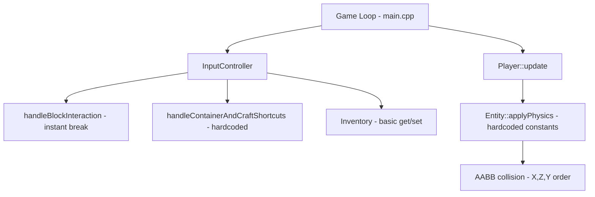
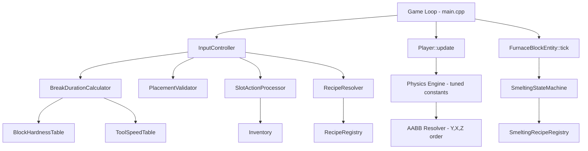

# Design Document: Phase 2 Core Mechanics Parity

## Overview

Phase 2 replaces six stub/hardcoded systems with parity-aligned implementations targeting Minecraft Java Edition 1.8.9 behavior. The current codebase scores 45.07/100 on the parity matrix; this phase targets ≥58 by closing all nine Domain B gaps (B-01 through B-09).

The work decomposes into three subphases:

- **Subphase 2.1 – Movement & Physics**: Tune walk/sprint velocity, jump/gravity constants, ground friction, and AABB collision resolution order to match 1.8.9 profiles within tolerance.
- **Subphase 2.2 – Block Interaction, Inventory & Crafting**: Add break-duration calculator with hardness/tool tables, placement validator with adjacency and entity collision checks, slot action processor with cursor-stack semantics, and a recipe registry with shaped/shapeless resolution.
- **Subphase 2.3 – Smelting & Validation**: Implement tick-based furnace state machine with fuel/progress tracking, plus a 30-minute survival scenario runner for end-to-end validation.

All new subsystems are designed as pure-logic components testable without OpenGL context, integrated into the existing `GameContext` through thin call sites in `Player::handleInput`, `InputController`, and the game loop tick.

## Architecture

### Current Architecture



### Target Architecture



### Integration Strategy

Each new component is a standalone C++ class/namespace with no OpenGL dependencies:

1. **Physics tuning** – Modify constants and friction model in `Entity::applyPhysics` and `Player::handleInput`. No new files needed; changes are in-place.
2. **BreakDurationCalculator** – New header+source pair. Called from `handleBlockInteraction` replacing instant-break logic.
3. **PlacementValidator** – New header+source pair. Called from the right-click placement path in `handleBlockInteraction`.
4. **SlotActionProcessor** – New header+source pair. Called from inventory UI click handlers (replacing direct `setStack`/`removeStack` calls).
5. **RecipeResolver + RecipeRegistry** – New header+source pair. Replaces the hardcoded C-key shortcut.
6. **SmeltingStateMachine** – Logic added to `FurnaceBlockEntity`. Called each game tick from the game loop. Replaces the Y-key instant-smelt shortcut.

All new source files are added to `TEST_SHARED_SOURCES` in CMakeLists.txt so tests can link them without the full game executable.


## Components and Interfaces

### 1. Physics Engine Tuning (Subphase 2.1)

**Files modified**: `include/entity/Entity.hpp`, `include/physics/Player.hpp`, `src/physics/Player.cpp`

The current `Entity::applyPhysics` uses hardcoded gravity (24.0) and no friction model. `Player::handleInput` sets velocity directly with no deceleration curve.

**Changes**:

```cpp
// New constants in a physics namespace (include/physics/PhysicsConstants.hpp)
namespace PhysicsConstants {
    constexpr float WALK_SPEED       = 4.317f;   // m/s horizontal
    constexpr float SPRINT_SPEED     = 5.612f;   // m/s horizontal
    constexpr float JUMP_VELOCITY    = 0.42f;    // blocks/tick (MC 1.8.9 initial upward velocity)
    constexpr float GRAVITY          = 0.08f;    // blocks/tick² (MC 1.8.9 gravity per tick)
    constexpr float TERMINAL_VEL     = 3.92f;    // blocks/tick (≈78.4 m/s at 20 tps)
    constexpr float GROUND_FRICTION  = 0.6f;     // ground slipperiness factor
    constexpr float AIR_DRAG         = 0.91f;    // horizontal drag while airborne
    constexpr float GROUND_ACCEL     = 0.1f;     // acceleration factor on ground
    constexpr float AIR_ACCEL        = 0.02f;    // acceleration factor in air
    constexpr float ICE_SLIPPERINESS = 0.98f;    // ice block slipperiness
    constexpr float TICK_RATE        = 20.0f;    // ticks per second
}
```

**Friction model** (replaces instant velocity zeroing):
- Each tick: `velocity.xz *= drag_factor` where `drag_factor = slipperiness * 0.91` on ground, `0.91` in air.
- Movement input applies acceleration (`ground_accel` or `air_accel`) scaled by the movement mode speed, not direct velocity assignment.
- Diagonal normalization: if both forward and strafe are active, normalize the input direction vector before applying acceleration.

**AABB resolution order change**: Current order is X, Z, Y. Change to Y, X, Z to match MC 1.8.9 axis resolution priority. This is a single reorder in `Entity::applyPhysics`.

**Jump velocity**: Replace `velocity.y = 8.0f` with the MC 1.8.9 tick-based jump: `velocity.y = JUMP_VELOCITY` (in blocks/tick units), with gravity applied per-tick as `velocity.y -= GRAVITY` and capped at `TERMINAL_VEL`.

**Tick-based vs delta-time**: The current physics uses variable `deltaTime`. For parity, the physics step should use a fixed tick accumulator (1/20s ticks) with the MC 1.8.9 per-tick formulas. The game loop accumulates real time and steps physics in fixed increments.

### 2. BreakDurationCalculator (Subphase 2.2)

**New files**: `include/mechanics/BreakDurationCalculator.hpp`, `src/mechanics/BreakDurationCalculator.cpp`

```cpp
struct BlockHardness {
    float hardness;       // base hardness (e.g., stone=1.5, dirt=0.5, obsidian=50)
    bool requiresTool;    // true if hand mining yields no drop
    ToolType preferredTool; // PICKAXE, AXE, SHOVEL, NONE
};

enum class ToolType { NONE, PICKAXE, AXE, SHOVEL, SWORD };
enum class ToolTier { HAND, WOOD, STONE, IRON, DIAMOND };

struct ToolSpeed {
    ToolType type;
    ToolTier tier;
    float speedMultiplier; // wood=2, stone=4, iron=6, diamond=8
};

class BreakDurationCalculator {
public:
    // Returns break time in seconds. -1.0f for unbreakable blocks.
    static float calculate(BlockID blockId, ToolType heldTool, ToolTier heldTier);

    // Query hardness table
    static const BlockHardness& getHardness(BlockID blockId);

    // Query tool speed
    static float getToolSpeed(ToolType type, ToolTier tier);
};
```

**Formula** (MC 1.8.9):
1. If `hardness < 0` (bedrock): return -1 (unbreakable).
2. `speedMultiplier = 1.0` (hand).
3. If held tool matches preferred tool: `speedMultiplier = toolTierSpeed`.
4. `damage = speedMultiplier / hardness / (requiresTool && !correctTool ? 100.0 : 30.0)`.
5. If `damage >= 1.0`: instant break (1 tick).
6. Else: `ticks = ceil(1.0 / damage)`, `breakTime = ticks / 20.0`.

**Integration**: `handleBlockInteraction` tracks `breakingBlockPos`, `breakProgress` (float 0→1), and `breakStartTime`. Each frame, if left-mouse is held and target block hasn't changed, increment progress. When progress ≥ 1.0, break the block. If button released or target changes, reset to 0.

### 3. PlacementValidator (Subphase 2.2)

**New files**: `include/mechanics/PlacementValidator.hpp`, `src/mechanics/PlacementValidator.cpp`

```cpp
struct PlacementResult {
    bool valid;
    std::string reason; // empty if valid
};

class PlacementValidator {
public:
    // Validate a block placement at worldPos, placed against face of adjacentPos
    static PlacementResult validate(
        const glm::ivec3& placePos,
        const glm::ivec3& againstPos,
        BlockID blockToPlace,
        const World& world,
        const AABB& playerAABB,
        const std::vector<AABB>& entityAABBs
    );

    // Compute facing-based metadata for directional blocks
    static uint8_t computeDirectionalMeta(BlockID blockId, float playerYaw);
};
```

**Validation rules** (checked in order):
1. `placePos` must be air (not occupied by solid block).
2. `againstPos` must be a solid block (adjacency requirement).
3. Block AABB at `placePos` must not intersect `playerAABB`.
4. Block AABB at `placePos` must not intersect any entity AABB.
5. For directional blocks (furnace, chest): compute metadata from player yaw.

### 4. SlotActionProcessor (Subphase 2.2)

**New files**: `include/mechanics/SlotActionProcessor.hpp`, `src/mechanics/SlotActionProcessor.cpp`

```cpp
enum class ClickAction { LEFT_CLICK, RIGHT_CLICK, SHIFT_CLICK };

struct SlotActionResult {
    ItemStack cursorAfter;
    ItemStack slotAfter;
    bool changed;
};

class SlotActionProcessor {
public:
    // Process a click on a slot. Returns the new cursor and slot state.
    static SlotActionResult processClick(
        ClickAction action,
        const ItemStack& cursor,
        const ItemStack& slot,
        int maxStackSize = 64
    );

    // Process shift-click transfer from sourceSlot to target inventory region.
    // Returns true if any items were transferred.
    static bool processShiftClick(
        Inventory& source, int sourceSlot,
        Inventory& target, int targetStart, int targetEnd
    );
};
```

**Left-click semantics**:
- Cursor empty + slot non-empty → pick up full stack (cursor = slot, slot = empty).
- Cursor non-empty + slot empty → place full stack (slot = cursor, cursor = empty).
- Cursor non-empty + slot same type → merge up to max stack size, remainder stays on cursor.
- Cursor non-empty + slot different type → swap.

**Right-click semantics**:
- Cursor non-empty + slot empty → place 1 item from cursor into slot.
- Cursor non-empty + slot same type → place 1 item from cursor into slot (if not full).
- Cursor empty + slot non-empty → pick up half (rounded up) onto cursor.
- Cursor non-empty + slot different type → swap (same as left-click).

**Shift-click semantics**:
- Transfer stack from source slot to first available slot in opposite region (hotbar slots 0-8 ↔ main inventory slots 9-35).
- Try merging with existing same-type stacks first, then empty slots.

**Cursor stack storage**: Add `ItemStack cursorStack` field to `GameContext` (or a new `InventoryUIState` struct) to track the item held on the cursor during inventory interaction.

### 5. RecipeResolver + RecipeRegistry (Subphase 2.2)

**New files**: `include/mechanics/RecipeRegistry.hpp`, `src/mechanics/RecipeRegistry.cpp`

```cpp
struct RecipeSlot {
    ItemID itemID;  // 0 = empty/wildcard
    int metadata;   // -1 = any metadata
};

struct ShapedRecipe {
    int width, height;                    // 1-3 each
    std::vector<RecipeSlot> pattern;      // row-major, size = width*height
    ItemStack output;
    int priority;                         // higher = more specific
};

struct ShapelessRecipe {
    std::vector<RecipeSlot> ingredients;  // unordered
    ItemStack output;
    int priority;
};

struct RecipeMatch {
    bool found;
    ItemStack output;
    int recipeIndex;  // index into registry for consumption
};

class RecipeRegistry {
public:
    void registerShaped(const ShapedRecipe& recipe);
    void registerShapeless(const ShapelessRecipe& recipe);

    // Resolve a grid (2x2 or 3x3) to an output. Grid is row-major.
    RecipeMatch resolve(const std::vector<ItemStack>& grid, int gridWidth, int gridHeight) const;

    // Consume inputs from grid after crafting
    void consumeInputs(std::vector<ItemStack>& grid, int recipeIndex) const;

    // Load parity-critical recipes
    void loadDefaultRecipes();

private:
    std::vector<ShapedRecipe> m_shaped;
    std::vector<ShapelessRecipe> m_shapeless;

    RecipeMatch matchShaped(const std::vector<ItemStack>& grid, int w, int h) const;
    RecipeMatch matchShapeless(const std::vector<ItemStack>& grid) const;
};
```

**Resolution algorithm**:
1. Try all shaped recipes: slide the recipe pattern across the grid (allowing offset). Match if all non-empty recipe slots match grid items.
2. Try all shapeless recipes: check if grid contains exactly the required ingredients (order-independent).
3. Among all matches, select highest priority. Ties broken by shaped > shapeless, then first-registered.
4. If no match, return `{false, {}, -1}`.

**Parity-critical recipes** (Requirement 8.8):
- Planks (4) from Log (1) – shapeless
- Sticks (4) from Planks (2) – shaped 1×2
- Crafting Table (1) from Planks (4) – shaped 2×2
- Wooden Pickaxe (1) from Planks (3) + Sticks (2) – shaped 3×3
- Stone Pickaxe (1) from Cobblestone (3) + Sticks (2) – shaped 3×3
- Wooden Sword (1) from Planks (2) + Sticks (1) – shaped 1×3
- Furnace (1) from Cobblestone (8) – shaped 3×3
- Chest (1) from Planks (8) – shaped 3×3
- Torches (4) from Coal (1) + Stick (1) – shaped 1×2

### 6. SmeltingStateMachine (Subphase 2.3)

**Files modified**: `include/world/FurnaceBlockEntity.hpp`, `src/world/FurnaceBlockEntity.cpp` (new tick logic)

**New files**: `include/mechanics/SmeltingRecipeRegistry.hpp`, `src/mechanics/SmeltingRecipeRegistry.cpp`

```cpp
enum class FurnaceState { IDLE, ACTIVE };

struct SmeltingRecipe {
    ItemID inputID;
    ItemStack output;
    int smeltDuration;  // ticks (default 200 = 10 seconds)
};

struct FuelEntry {
    ItemID fuelID;
    int burnDuration;   // ticks (coal=1600, planks=300, sticks=100, logs=300)
};

class SmeltingRecipeRegistry {
public:
    void registerRecipe(const SmeltingRecipe& recipe);
    void registerFuel(const FuelEntry& fuel);
    const SmeltingRecipe* findRecipe(ItemID inputID) const;
    const FuelEntry* findFuel(ItemID fuelID) const;
    void loadDefaults();
private:
    std::vector<SmeltingRecipe> m_recipes;
    std::vector<FuelEntry> m_fuels;
};
```

**FurnaceBlockEntity extended**:

```cpp
class FurnaceBlockEntity : public BlockEntity {
public:
    Inventory inventory;  // slot 0=input, 1=fuel, 2=output
    FurnaceState state = FurnaceState::IDLE;
    int burnTimeRemaining = 0;   // ticks of fuel left
    int burnTimeTotal = 0;       // total burn time of current fuel (for UI progress)
    int smeltProgress = 0;       // ticks of current smelt progress
    int smeltDuration = 200;     // ticks needed to complete smelt

    void tick(const SmeltingRecipeRegistry& registry);
    // ... serialize/deserialize updated to include new fields
};
```

**State machine logic** (`tick` method):

```
if state == IDLE:
    if input slot has smeltable item AND fuel slot has fuel:
        consume 1 fuel, set burnTimeRemaining = fuel.burnDuration
        set smeltDuration from recipe
        state = ACTIVE

if state == ACTIVE:
    burnTimeRemaining -= 1

    if input slot has smeltable item AND output slot not full:
        smeltProgress += 1
        if smeltProgress >= smeltDuration:
            consume 1 input, produce 1 output
            smeltProgress = 0
    else:
        // input empty or output full: pause smelt progress (don't reset if fuel still burning)

    if burnTimeRemaining <= 0:
        if input slot has smeltable item AND fuel slot has fuel:
            consume 1 fuel, reset burnTimeRemaining
        else:
            state = IDLE
            smeltProgress = 0
```

**Parity-critical smelting recipes** (Requirement 9.9):
- Cobblestone → Stone (200 ticks)
- Iron Ore → Iron Ingot (200 ticks)
- Sand → Glass (200 ticks)
- Raw food → Cooked food (200 ticks)

**Integration**: The game loop calls `furnaceBlockEntity->tick(registry)` once per game tick for every loaded furnace. This replaces the Y-key instant-smelt shortcut.


## Data Models

### Block Hardness Table

Static lookup table mapping `BlockID` → `BlockHardness`. Initialized at startup.

| Block | Hardness | Requires Tool | Preferred Tool |
|-------|----------|---------------|----------------|
| Stone | 1.5 | Yes | Pickaxe |
| Grass | 0.6 | No | Shovel |
| Dirt | 0.5 | No | Shovel |
| Cobblestone | 2.0 | Yes | Pickaxe |
| Planks | 2.0 | No | Axe |
| Bedrock | -1.0 | — | — |
| Sand | 0.5 | No | Shovel |
| Gravel | 0.6 | No | Shovel |
| Log | 2.0 | No | Axe |
| Leaves | 0.2 | No | None |
| Furnace | 3.5 | Yes | Pickaxe |
| Chest | 2.5 | No | Axe |

### Tool Speed Table

| Tool Type | Tier | Speed Multiplier |
|-----------|------|-----------------|
| Hand | — | 1.0 |
| Pickaxe | Wood | 2.0 |
| Pickaxe | Stone | 4.0 |
| Pickaxe | Iron | 6.0 |
| Pickaxe | Diamond | 8.0 |
| Axe | Wood | 2.0 |
| Axe | Stone | 4.0 |
| Axe | Iron | 6.0 |
| Axe | Diamond | 8.0 |
| Shovel | Wood | 2.0 |
| Shovel | Stone | 4.0 |
| Shovel | Iron | 6.0 |
| Shovel | Diamond | 8.0 |

### Block Slipperiness Table

| Block | Slipperiness Factor |
|-------|-------------------|
| Default | 0.6 |
| Ice | 0.98 |

### Fuel Burn Duration Table

| Fuel Item | Burn Duration (ticks) |
|-----------|----------------------|
| Coal | 1600 |
| Planks | 300 |
| Sticks | 100 |
| Log | 300 |

### Smelting Recipe Table

| Input | Output | Duration (ticks) |
|-------|--------|-----------------|
| Cobblestone | Stone | 200 |
| Iron Ore | Iron Ingot | 200 |
| Sand | Glass | 200 |
| Raw Beef | Cooked Beef | 200 |
| Raw Porkchop | Cooked Porkchop | 200 |

### Inventory Layout Constants

| Region | Slot Range | Description |
|--------|-----------|-------------|
| Hotbar | 0–8 | Quick-access bar |
| Main Inventory | 9–35 | Main storage grid (3×9) |
| Crafting Grid (2×2) | 36–39 | Player inventory crafting |
| Crafting Grid (3×3) | 0–8 (crafting table) | Crafting table grid |
| Furnace Input | 0 | Smeltable item |
| Furnace Fuel | 1 | Fuel item |
| Furnace Output | 2 | Smelted result |

### Recipe Data Structure (in-memory)

Recipes are registered at startup via `RecipeRegistry::loadDefaultRecipes()`. Each recipe is a struct stored in a `std::vector`. Resolution iterates all recipes per grid change (small N, no performance concern). No external data files; recipes are code-defined constants matching MC 1.8.9 values.


## Correctness Properties

*A property is a characteristic or behavior that should hold true across all valid executions of a system — essentially, a formal statement about what the system should do. Properties serve as the bridge between human-readable specifications and machine-verifiable correctness guarantees.*

### Property 1: Movement mode speed convergence

*For any* movement mode (walk or sprint) and any player on flat ground moving forward, the steady-state horizontal speed after sufficient ticks should equal the mode's target speed (4.317 m/s for walk, 5.612 m/s for sprint) within 8% tolerance.

**Validates: Requirements 1.1, 1.2**

### Property 2: Diagonal speed cap

*For any* combination of forward and strafe input and any movement mode, the resulting horizontal velocity magnitude should never exceed the active movement mode's target speed.

**Validates: Requirements 1.4**

### Property 3: Per-tick friction factor

*For any* player with non-zero horizontal velocity who releases all movement input, the horizontal velocity after one physics tick should equal the previous velocity multiplied by the surface-specific friction factor (0.6 × 0.91 on ground, 0.91 in air, 0.98 × 0.91 on ice), not zero.

**Validates: Requirements 1.5, 3.1, 3.3, 3.4**

### Property 4: Jump profile bounds

*For any* jump initiated from flat ground with zero initial vertical velocity, the apex height gain should be in [1.15, 1.25] blocks and the full jump cycle (liftoff to landing) should complete in [0.55, 0.75] seconds.

**Validates: Requirements 2.1, 2.2**

### Property 5: Terminal velocity cap

*For any* falling player, the downward velocity magnitude should never exceed the terminal velocity cap (approximately 3.92 blocks/tick, i.e., 78.4 m/s at 20 tps).

**Validates: Requirements 2.4**

### Property 6: Collision no-penetration invariant

*For any* player position after physics resolution, the player AABB should not overlap any solid block AABB in the world.

**Validates: Requirements 4.2**

### Property 7: Corner sliding

*For any* player moving diagonally into a corner formed by two solid blocks, the player should slide along the unblocked axis (position should change on the free axis) rather than becoming stuck.

**Validates: Requirements 4.6**

### Property 8: Break duration formula correctness

*For any* block ID with defined hardness and any tool type/tier combination, the computed break duration should match the MC 1.8.9 formula: `ticks = ceil(1.0 / (speedMultiplier / hardness / divisor))` where `divisor = 30` if correct tool or no tool required, `100` otherwise. Unbreakable blocks (hardness < 0) should return -1.

**Validates: Requirements 5.1, 5.2, 5.3, 5.7**

### Property 9: Break progress reset on interruption

*For any* in-progress block break (progress > 0), if the player releases the break button or changes target block, the break progress should reset to zero.

**Validates: Requirements 5.5**

### Property 10: Placement validity

*For any* block placement attempt at position P, the placement should succeed if and only if: (a) P is air, (b) P is adjacent to a solid block, (c) the block AABB at P does not intersect the player AABB, and (d) the block AABB at P does not intersect any entity AABB.

**Validates: Requirements 6.1, 6.2, 6.3, 6.4**

### Property 11: Directional block orientation

*For any* player yaw angle and any directional block type (furnace, chest), the computed facing metadata should map to the correct cardinal direction (N/S/E/W) based on the yaw quadrant.

**Validates: Requirements 6.6**

### Property 12: Left-click item conservation

*For any* left-click on an inventory slot, the total item count across cursor and slot is preserved (cursor.count + slot.count before == cursor.count + slot.count after), and: empty cursor picks up full stack, same-type merges up to max, different-type swaps.

**Validates: Requirements 7.1, 7.2, 7.3**

### Property 13: Right-click semantics

*For any* right-click on an inventory slot: if cursor is non-empty and slot is empty or same type, exactly 1 item moves from cursor to slot; if cursor is empty and slot is non-empty, ceil(count/2) items move from slot to cursor. Total items are conserved.

**Validates: Requirements 7.4, 7.5**

### Property 14: Shift-click transfer

*For any* shift-click on a slot in the hotbar region, the stack should transfer to the first available slot in the main inventory region (and vice versa). The total item count across both regions is preserved.

**Validates: Requirements 7.6**

### Property 15: Recipe resolution round-trip

*For any* valid recipe input (grid contents matching a registered recipe), resolving the grid should produce the registered recipe's output item and quantity. Re-resolving the same grid should produce the same result (idempotent).

**Validates: Requirements 8.1, 8.2, 8.9**

### Property 16: Shapeless recipe order independence

*For any* shapeless recipe and any permutation of its ingredients placed in the grid, the resolved output should be identical.

**Validates: Requirements 8.3**

### Property 17: Recipe priority resolution

*For any* grid state that matches multiple registered recipes, the resolver should select the recipe with the highest priority value.

**Validates: Requirements 8.4**

### Property 18: No-match produces no output

*For any* grid state that does not match any registered recipe, the resolver should return an empty/no-match result.

**Validates: Requirements 8.5**

### Property 19: Crafting input consumption conservation

*For any* successful craft, the items consumed from the grid should exactly equal the recipe's required inputs. No items are created or destroyed beyond the recipe's defined input→output transformation.

**Validates: Requirements 8.6**

### Property 20: Furnace state transitions

*For any* furnace in Idle state with a valid smeltable input and fuel, ticking should transition to Active. For any furnace in Active state with burnTimeRemaining reaching zero and no fuel available, ticking should transition to Idle and reset smelt progress.

**Validates: Requirements 9.1, 9.4, 9.5**

### Property 21: Furnace tick progress

*For any* Active furnace with smeltable input and non-full output, each tick should decrement burnTimeRemaining by 1 and increment smeltProgress by 1. When smeltProgress reaches smeltDuration, exactly 1 input item is consumed and 1 output item is produced, and smeltProgress resets to 0.

**Validates: Requirements 9.2, 9.3**

### Property 22: Furnace smelt pause conditions

*For any* Active furnace where the output slot is full (64 items) or the input slot is empty, smeltProgress should not increment on tick, even if fuel is still burning. Fuel burn timer should still decrement.

**Validates: Requirements 9.6, 9.7**

### Property 23: Movement replay determinism

*For any* sequence of movement inputs applied to identical initial conditions, replaying the sequence multiple times should produce identical position traces (position delta < 0.001 blocks between runs).

**Validates: Requirements 2.5, 10.1**

### Property 24: Inventory action replay determinism

*For any* sequence of slot actions (left-click, right-click, shift-click) applied to identical initial inventory state, replaying the sequence should produce identical final inventory state across runs.

**Validates: Requirements 7.8**


## Error Handling

### Physics Engine

- **NaN/Inf velocity**: If velocity becomes NaN or Inf (e.g., from division by zero in friction), clamp to zero and log a warning. This prevents the player from teleporting or crashing.
- **Excessive delta time**: If the tick accumulator accumulates more than 10 ticks worth of time (e.g., after a long frame stall), cap at 10 ticks to prevent physics explosion.
- **Out-of-bounds position**: If player position exceeds world bounds after physics step, clamp to valid range.

### BreakDurationCalculator

- **Unknown BlockID**: If a block ID is not in the hardness table, return a default hardness of 1.0 (breakable by hand). Log a warning.
- **Negative hardness**: Only bedrock should have negative hardness (unbreakable). Return -1.0f for any block with hardness < 0.

### PlacementValidator

- **Unloaded chunk**: If the target position is in an unloaded chunk, reject placement with reason "chunk not loaded".
- **Invalid block ID**: If the block to place is not a valid placeable block, reject with reason "invalid block type".

### SlotActionProcessor

- **Out-of-range slot index**: If slot index is outside inventory bounds, return unchanged state (no-op). Log a warning.
- **Stack overflow**: If merging would exceed max stack size, only transfer up to the limit. Remainder stays on cursor.
- **Null item registry entry**: If `ItemRegistry::getItem` returns nullptr for a stack's item ID, use default max stack size of 64.

### RecipeResolver

- **Empty grid**: Return no-match immediately (fast path).
- **Corrupted recipe data**: If a registered recipe has zero-size pattern or empty ingredients, skip it during resolution. Log at registration time.

### SmeltingStateMachine

- **Missing recipe**: If input item has no matching smelting recipe, remain in Idle. Do not consume fuel.
- **Missing fuel entry**: If fuel slot item is not in the fuel registry, treat as non-fuel (cannot start smelting).
- **Output slot type mismatch**: If output slot contains a different item type than the recipe output, pause smelting (do not overwrite).
- **Serialization version mismatch**: When deserializing furnace state, if new fields (state, burnTimeRemaining, smeltProgress) are missing, default to Idle with zero timers (backward compatibility with existing saves).

### Survival Scenario Runner

- **Crash detection**: Wrap each scenario tick in a try-catch. On exception, log tick number, player state snapshot, and last action. Mark run as failed.
- **Timeout**: If a scenario exceeds 35 minutes wall-clock time, abort and mark as failed (prevents infinite loops).

## Testing Strategy

### Test Topology

All tests integrate into the existing CTest structure with four targets:

| CTest Target | New Tests Added | Purpose |
|---|---|---|
| `tests_data` | Smelting recipe registry serialization | Data integrity |
| `tests_runtime` | BreakDurationCalculator, PlacementValidator, SlotActionProcessor, RecipeResolver, SmeltingStateMachine unit + property tests | Core logic validation |
| `tests_gameplay_smoke` | Movement replay (walk, sprint, friction, jump), inventory action replay, crafting replay, smelting lifecycle replay, survival scenario | End-to-end determinism and stability |
| `tests_render` | (no changes) | Render pipeline |

### Property-Based Testing Configuration

- **Library**: [rapidcheck](https://github.com/emil-e/rapidcheck) — C++ property-based testing library compatible with C++20 and CMake. Integrates as a FetchContent dependency.
- **Minimum iterations**: 100 per property test.
- **Tag format**: Each property test includes a comment: `// Feature: phase2-core-mechanics-parity, Property N: <title>`

### Dual Testing Approach

**Unit tests** (specific examples and edge cases):
- Jump apex with exact initial conditions (validates against known MC 1.8.9 reference values)
- Break duration for specific block/tool pairs (stone + iron pickaxe = 0.75s, dirt + hand = 0.75s)
- Bedrock unbreakable (edge case from 5.7)
- Block edge collision (edge case from 4.3)
- 1-block gap rejection (edge case from 4.4)
- AABB Y,X,Z resolution order (specific scenario from 4.1)
- Parity-critical recipe checklist (8.8): verify each of the 9 required recipes resolves correctly
- Parity-critical smelting recipe checklist (9.9): verify each required smelting recipe
- Speed curve deviation ≤ 8% against reference (1.3)
- Deceleration profile error ≤ 10% against reference (3.2)
- Survival scenario 30-minute run (11.1, 11.2, 11.4)

**Property tests** (universal properties, 100+ iterations each):
- Property 1: Movement mode speed convergence — `// Feature: phase2-core-mechanics-parity, Property 1: Movement mode speed convergence`
- Property 2: Diagonal speed cap — `// Feature: phase2-core-mechanics-parity, Property 2: Diagonal speed cap`
- Property 3: Per-tick friction factor — `// Feature: phase2-core-mechanics-parity, Property 3: Per-tick friction factor`
- Property 4: Jump profile bounds — `// Feature: phase2-core-mechanics-parity, Property 4: Jump profile bounds`
- Property 5: Terminal velocity cap — `// Feature: phase2-core-mechanics-parity, Property 5: Terminal velocity cap`
- Property 6: Collision no-penetration invariant — `// Feature: phase2-core-mechanics-parity, Property 6: Collision no-penetration invariant`
- Property 7: Corner sliding — `// Feature: phase2-core-mechanics-parity, Property 7: Corner sliding`
- Property 8: Break duration formula correctness — `// Feature: phase2-core-mechanics-parity, Property 8: Break duration formula correctness`
- Property 9: Break progress reset on interruption — `// Feature: phase2-core-mechanics-parity, Property 9: Break progress reset on interruption`
- Property 10: Placement validity — `// Feature: phase2-core-mechanics-parity, Property 10: Placement validity`
- Property 11: Directional block orientation — `// Feature: phase2-core-mechanics-parity, Property 11: Directional block orientation`
- Property 12: Left-click item conservation — `// Feature: phase2-core-mechanics-parity, Property 12: Left-click item conservation`
- Property 13: Right-click semantics — `// Feature: phase2-core-mechanics-parity, Property 13: Right-click semantics`
- Property 14: Shift-click transfer — `// Feature: phase2-core-mechanics-parity, Property 14: Shift-click transfer`
- Property 15: Recipe resolution round-trip — `// Feature: phase2-core-mechanics-parity, Property 15: Recipe resolution round-trip`
- Property 16: Shapeless recipe order independence — `// Feature: phase2-core-mechanics-parity, Property 16: Shapeless recipe order independence`
- Property 17: Recipe priority resolution — `// Feature: phase2-core-mechanics-parity, Property 17: Recipe priority resolution`
- Property 18: No-match produces no output — `// Feature: phase2-core-mechanics-parity, Property 18: No-match produces no output`
- Property 19: Crafting input consumption conservation — `// Feature: phase2-core-mechanics-parity, Property 19: Crafting input consumption conservation`
- Property 20: Furnace state transitions — `// Feature: phase2-core-mechanics-parity, Property 20: Furnace state transitions`
- Property 21: Furnace tick progress — `// Feature: phase2-core-mechanics-parity, Property 21: Furnace tick progress`
- Property 22: Furnace smelt pause conditions — `// Feature: phase2-core-mechanics-parity, Property 22: Furnace smelt pause conditions`
- Property 23: Movement replay determinism — `// Feature: phase2-core-mechanics-parity, Property 23: Movement replay determinism`
- Property 24: Inventory action replay determinism — `// Feature: phase2-core-mechanics-parity, Property 24: Inventory action replay determinism`

### CMake Integration

Add `rapidcheck` as a FetchContent dependency in `cmake/Dependencies.cmake`. Link `rapidcheck` to test targets that use property-based tests. New source files (`BreakDurationCalculator.cpp`, `PlacementValidator.cpp`, `SlotActionProcessor.cpp`, `RecipeRegistry.cpp`, `SmeltingRecipeRegistry.cpp`) are added to `TEST_SHARED_SOURCES` in CMakeLists.txt.

### Contribution Gate Compliance

All Phase 2 changes must pass:
1. `cmake --build . --config Release` — zero build errors
2. `ctest --test-dir build -C Release` — 100% pass rate on all four targets
3. New/modified physics code includes updated replay tests in `tests_gameplay_smoke`
4. New/modified inventory/crafting/smelting code includes regression tests in `tests_gameplay_smoke`
