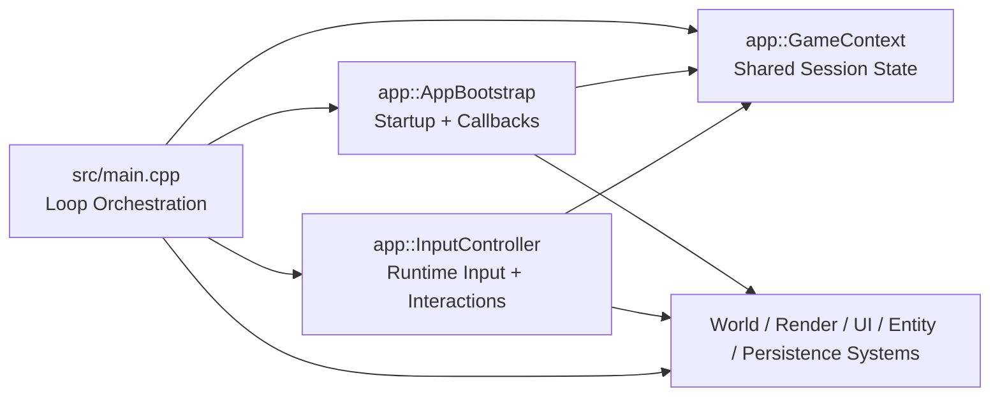

# Phase 1.1 Architecture Boundary Update

Subphase: 1.1 - Architecture Boundary Cut  
Roadmap reference: `docs/roadmap.md` (Section 6.2, Subphase 1.1)  
Update date: February 25, 2026

## 1. Boundary Scope

Subphase 1.1 extracted two runtime boundaries from `src/main.cpp`:

- `AppBootstrap`: startup orchestration, GLFW callback wiring, resource/bootstrap initialization.
- `InputController`: keyboard/mouse input processing, block interaction, container/crafting shortcut handling.

## 2. Module Ownership Matrix

| Module | Files | Ownership | Responsibilities |
|---|---|---|---|
| Shared runtime context | `include/app/GameContext.hpp` | WS-ARCH | Canonical game-session state used by loop, bootstrap, and input modules |
| Bootstrap boundary | `include/app/AppBootstrap.hpp`, `src/app/AppBootstrap.cpp` | WS-ARCH + WS-RENDER/WS-WORLD integration | Register block/item metadata, initialize runtime systems, wire framebuffer/mouse/scroll callbacks |
| Input boundary | `include/app/InputController.hpp`, `src/app/InputController.cpp` | WS-ARCH + WS-GAME integration | Process game/menu input state, block placement/break, container open/validation, craft/smelting shortcuts |
| Game loop orchestration | `src/main.cpp` | WS-ARCH | Frame timing, update-order orchestration, render pipeline orchestration, high-level loop lifecycle |

## 3. Dependency and Ownership Diagram

## 4. Boundary Rules (Post-1.1)

- `src/main.cpp` should not re-introduce low-level callback wiring or key-by-key input branching.
- Startup-time asset/block/item registration belongs to `AppBootstrap`.
- Input-driven world mutation and container state transitions belong to `InputController`.
- New game-loop domains should prefer new modules instead of expanding `main.cpp`.

## 5. Verification Evidence

- Configure log: `docs/quality/logs/subphase-1.1-configure.log`
- Build log: `docs/quality/logs/subphase-1.1-build.log`
- Test log: `docs/quality/logs/subphase-1.1-ctest.log`
